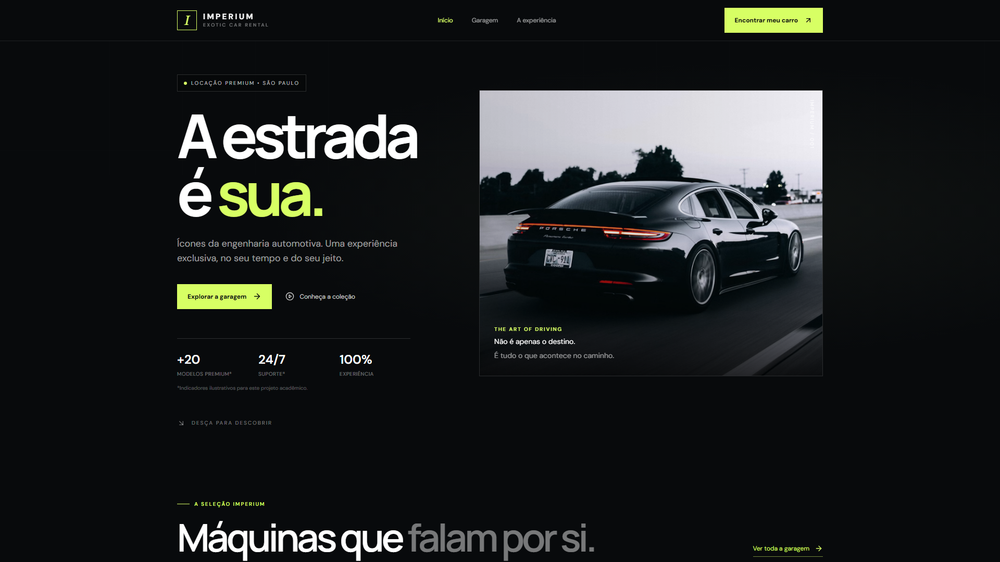
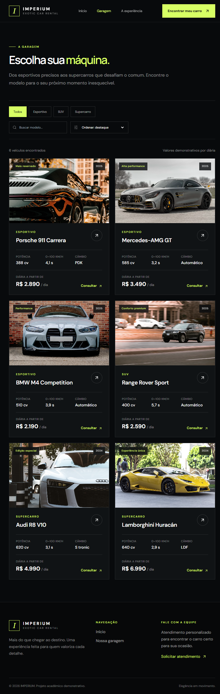

<div align="center">

# 🏎️ IMPERIUM — Exotic Car Rental

**Locação de carros importados · experiência premium, sob demanda**


[](https://imperium-cars-cp6.vercel.app)
[](https://github.com/TurbineAG/imperium-cars-cp6)
[](https://github.com/TurbineAG/imperium-cars-cp6/pulls?q=is%3Apr+is%3Amerged)

**[🌐 Demonstração](https://imperium-cars-cp6.vercel.app)** · **[📦 Repositório](https://github.com/TurbineAG/imperium-cars-cp6)** · **[🗂️ Entrega](#-entrega)**

<br/>



</div>

---

## ✨ Sobre o projeto

O **IMPERIUM** é uma plataforma web de **locação de carros importados** desenvolvida para o
Checkpoint 6 da disciplina de Web Development. O foco do projeto está em **organização e fluxo de
trabalho**: estrutura de pastas limpa, commits semânticos, trabalho por branches e Pull Requests
revisados antes de chegar à `main`.

A interface apresenta uma vitrine premium com catálogo filtrável, ficha técnica de cada veículo,
valores por dia e navegação por rotas.

## 🗺️ Páginas e rotas

| Rota | Página | Conteúdo |
| --- | --- | --- |
| `/` | `Home` | Hero, seleção de destaques, diferenciais e chamada para ação |
| `/carros` | `Carros` | Catálogo completo com filtro por categoria, busca e ordenação |
| `*` | `Home` | Redirecionamento para a página inicial |

> As rotas são configuradas no `src/App.jsx` com `react-router-dom`.

## 🗂️ Estrutura do projeto

```
imperium-cars-cp6/
├── docs/                     # imagens da documentação
├── src/
│   ├── components/
│   │   ├── Navbar.jsx        # navegação superior responsiva
│   │   ├── Footer.jsx        # rodapé do site
│   │   └── CarCard.jsx       # card de veículo (reutilizado nas duas páginas)
│   ├── pages/
│   │   ├── Home.jsx          # página inicial
│   │   └── Carros.jsx        # catálogo com filtros
│   ├── data/
│   │   └── cars.js           # catálogo de veículos + formatação de preço
│   ├── App.jsx               # rotas da aplicação
│   ├── main.jsx              # entry point (BrowserRouter)
│   └── index.css             # tema e utilidades Tailwind
├── .vscode/                  # configuração da IDE (extensões recomendadas)
├── integrante.txt            # arquivo de entrega (RM, nome e link)
├── vercel.json               # rewrite SPA para o deploy
├── tailwind.config.js
├── vite.config.js
└── package.json
```

## 🛠️ Stack

| Camada | Tecnologia |
| --- | --- |
| Biblioteca de UI | React 18 |
| Build | Vite 6 |
| Estilo | Tailwind CSS 3 + PostCSS/Autoprefixer |
| Rotas | React Router DOM 6 |
| Ícones | Lucide React |
| Deploy | Vercel |

## ▶️ Como executar localmente

```bash
# 1. instalar dependências
npm install

# 2. ambiente de desenvolvimento (http://localhost:5173)
npm run dev

# 3. gerar build de produção
npm run build

# 4. testar a build localmente
npm run preview
```

## ☁️ Deploy

- **Produção:** [https://imperium-cars-cp6.vercel.app](https://imperium-cars-cp6.vercel.app)
- Configuração em `vercel.json` com rewrite de SPA, garantindo que rotas diretas
  (ex.: `/carros`) carreguem corretamente sem erro 404.

## 🔀 Fluxo de versionamento (CP6)

**Regras seguidas:** commits semânticos (Conventional Commits), uma branch por tarefa,
Pull Request para a `dev`, revisão do Tech Lead e merge — e a entrega final sai da `main`.

| Tarefa | Branch | Pull Request | Commits |
| --- | --- | --- | --- |
| 1. Configuração e limpeza do projeto | `chore/setup-project` | [#1](https://github.com/TurbineAG/imperium-cars-cp6/pull/1) | 4 |
| 2. Componentes (navbar, footer, card) | `feat/componentes` | [#2](https://github.com/TurbineAG/imperium-cars-cp6/pull/2) | 4 |
| 3. Páginas (home, Carros) e rotas | `feat/pages-rotas` | [#3](https://github.com/TurbineAG/imperium-cars-cp6/pull/3) | 4 |
| Entrega final `dev` → `main` | `dev` | [#4](https://github.com/TurbineAG/imperium-cars-cp6/pull/4) | — |
| Correção das fotos do catálogo | `fix/fotos-troca` | [#5](https://github.com/TurbineAG/imperium-cars-cp6/pull/5) · [#6](https://github.com/TurbineAG/imperium-cars-cp6/pull/6) | 4 |
| Deploy no Vercel e rotas | `chore/vercel-deploy` | [#7](https://github.com/TurbineAG/imperium-cars-cp6/pull/7) · [#8](https://github.com/TurbineAG/imperium-cars-cp6/pull/8) | 3 |

**Tipos de commit utilizados:** `feat:` · `fix:` · `chore:` · `style:` · `docs:`

## 📸 Telas

<table>
  <tr>
    <td align="center"><b>Início</b></td>
    <td align="center"><b>Garagem</b></td>
  </tr>
  <tr>
    <td></td>
    <td></td>
  </tr>
</table>

## 📄 Entrega

Na raiz do repositório está o arquivo **`integrante.txt`** com:

- **RM:** 571322
- **Nome:** Felipe Ilek
- **Link do repositório:** https://github.com/TurbineAG/imperium-cars-cp6 (público)
- **Link do site:** https://imperium-cars-cp6.vercel.app

## 👤 Identificação

| | |
| --- | --- |
| **Aluno** | Felipe Ilek — RM 571322 |
| **Turma** | 1ESPF |
| **Disciplina** | Web Development (Checkpoint 6) |
| **Professor** | Wellington Cidade Silva |
| **Organização** | [TurbineAG](https://github.com/TurbineAG) |

<div align="center">
  <sub>Projeto acadêmico desenvolvido com React + Vite + Tailwind CSS.</sub>
</div>
